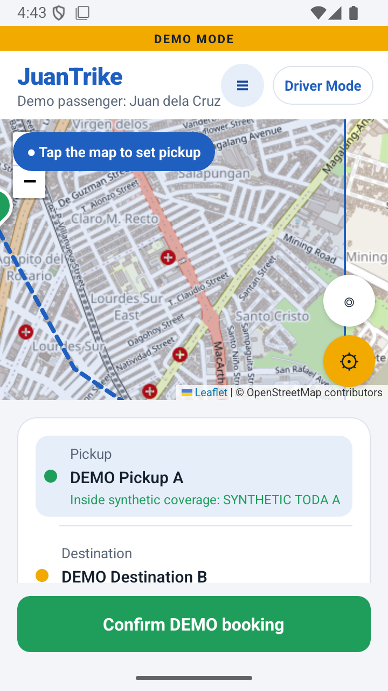
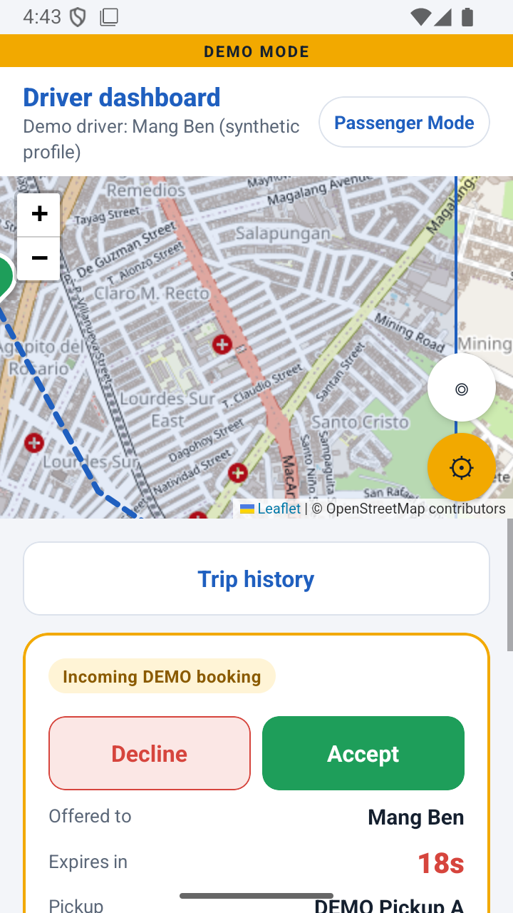
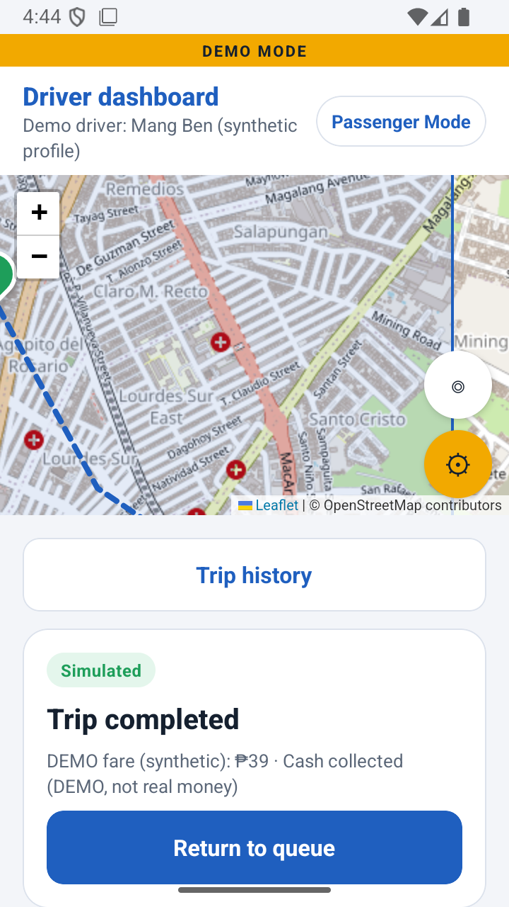
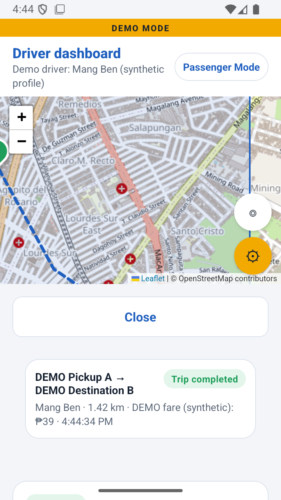
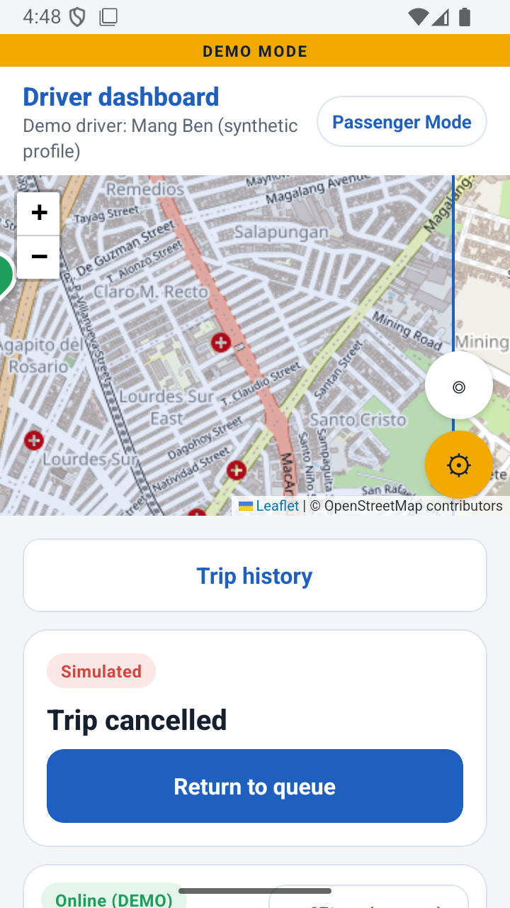
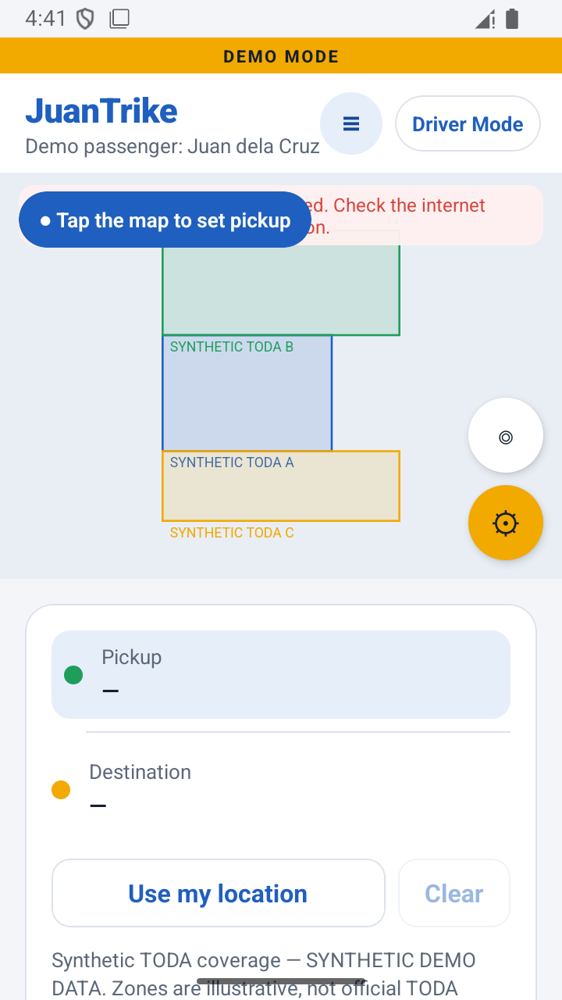

# JuanTrike

Intelligent Geofenced Tricycle E-Hailing System — Interactive Mobile Proof of Concept.

JuanTrike is an interactive Android proof of concept for tricycle ride booking: passenger and driver modes, simulated GPS navigation, automated FIFO driver matching, and TODA geofencing in Angeles City, Pampanga, Philippines. It is a presentation demo. It runs entirely on the device.

> **Synthetic demo.** Bookings, drivers, TODA zones, routes, fares and payments are simulated. No live transport operations are connected. The zones are illustrative and are not an LGU-approved operating area.

## Features

- Passenger and Driver modes, switchable from the header.
- Angeles City map using OpenStreetMap tiles (Leaflet inside a WebView), with an SVG fallback when tiles cannot load.
- Synthetic TODA-A, TODA-B and TODA-C geofencing, with coverage checks on pickup and destination.
- Pickup and destination selection by map tap, device location, or demo locations.
- Illustrative (DEMO) fare estimates.
- Automated FIFO driver matching with a three-offer dispatch demonstration: each offer has a 20-second window, and the booking ends if no eligible driver accepts.
- Driver decline and offer expiry handling.
- Simulated approach and trip movement along a route.
- Driver arrival, trip start and completion.
- Simulated cash payment, recorded as "DEMO collected".
- Passenger and driver trip histories.
- Demo control panel: pause/resume, speed (1x / 2x / 4x), role switch, restore demo locations, example booking, out-of-coverage example, advance state, cancel, and reset.
- English and Filipino interface.

## Technology

- [Expo](https://expo.dev) SDK 57 (`expo` ~57.0.28) with React Native 0.86.3 and React 19.2.3.
- `expo-location` (foreground location only, one-shot reads), `expo-device`, `expo-status-bar`, `expo-system-ui`.
- `react-native-webview` 13.16.1 for the map, which loads Leaflet 1.9.4 from cdnjs and OpenStreetMap tiles.
- `react-native-safe-area-context` 5.7.
- TypeScript, Jest with `jest-expo` and `@testing-library/react-native`, ESLint with `eslint-config-expo`.
- Expo Router is not used. The app is a single-screen state machine with React context.

The booking state machine lives in `src/booking/bookingMachine.ts`. The simulated clock and dispatch are in `src/booking/DemoContext.tsx`. Synthetic zones and drivers are in `src/booking/demoZones.ts`.

## Running the app

Requirements: Node.js with npm, and an Android emulator (x86_64 recommended).

```bash
npm install
npx expo start            # Metro dev server
```

Then open the app in an Android development build, or use the release APK below.

Checks:

```bash
npx tsc --noEmit          # typecheck
npx expo lint             # lint
npx jest                  # unit and state-machine tests
```

## Presentation demonstration

Full steps, timing and the troubleshooting notes for a slow emulator are in [`docs/presentation/PRESENTATION_RUNBOOK.md`](docs/presentation/PRESENTATION_RUNBOOK.md) (section 7 is the current run).

In short:

1. Choose **Passenger Mode**.
2. Open the demo panel (gear icon) and tap **Restore demo locations**, which sets pickup and destination inside SYNTHETIC TODA A.
3. Tap **Confirm DEMO booking**.
4. Tap **Driver Mode**. The offer appears at the top, with Decline and Accept.
5. Accept, then follow **Start toward pickup → Arrived at pickup → Start trip**. The trip completes automatically.
6. Open trip history on either side.

## APK download

The Android release APK (x86_64) is attached to the GitHub Release `v1.0.0-poc`. The link will be added here after publication.

Release details: `JuanTrike-x86_64-release.apk`, 27,752,032 bytes, SHA-256 `4bc3d3c3fef0219c316c62098a6af4272a5f570aadb15f7610435f99dd4fe37f`.

## Important limitations

- This is a standalone UI proof of concept. No live transport bookings are processed.
- GPS movement is simulated. The device location is read only once, when requested, and is never uploaded.
- TODA boundaries, drivers, terminals and fares are synthetic.
- The geography does not represent LGU-approved operating authority.
- No real cash or wallet payments are processed.
- The APK is x86_64 only, for Android emulators. It will not install on typical ARM64 phones.
- The APK uses a template debug keystore. It is not production-signed and is not ready for distribution.
- Map tiles need connectivity unless the WebView has cached them. When tiles cannot load, the app shows the zones as a drawing with an error message. That is a fallback, not an offline map.
- The app's map-tap and GPS paths were not used in the recorded presentation runs. The runs used the demo panel's restore control.

## Testing

Verified results (see [`docs/presentation/TEST_RESULTS.md`](docs/presentation/TEST_RESULTS.md) sections 9 to 12):

- TypeScript: pass.
- ESLint: pass.
- Jest: 64 of 64 pass across 5 suites.
- Two clean Android repeatability runs of the full positive booking on the final release APK (45 of 45 steps each).
- Three-offer scenario on the final release APK: pass (offers to Mang Ben, Mang Joel, Mang Ernie; then no driver).
- Offline map fallback on the release APK: pass, with the limitations above.
- Presentation acceptance: **PRESENTATION_READY for local emulator demonstration.**

These checks were run on Android emulators only. No physical Android phone was tested.

## Screenshots

Captured from the release build on the x86_64 emulator.

| Passenger assignment | Driver incoming offer | Trip completed (DEMO cash) |
|---|---|---|
|  |  |  |

| Driver history | Three offers, no driver | Offline map fallback |
|---|---|---|
|  |  |  |

The full gallery is in [`docs/presentation/SCREENSHOT_GALLERY.html`](docs/presentation/SCREENSHOT_GALLERY.html).

## Documentation

- [`docs/presentation/JUANTRIKE_POC_OVERVIEW.md`](docs/presentation/JUANTRIKE_POC_OVERVIEW.md)
- [`docs/presentation/PASSENGER_WORKFLOW.md`](docs/presentation/PASSENGER_WORKFLOW.md)
- [`docs/presentation/DRIVER_WORKFLOW.md`](docs/presentation/DRIVER_WORKFLOW.md)
- [`docs/presentation/GPS_GEOFENCING_DEMO.md`](docs/presentation/GPS_GEOFENCING_DEMO.md)
- [`docs/presentation/DEMO_SCENARIOS.md`](docs/presentation/DEMO_SCENARIOS.md)
- [`docs/presentation/PRESENTATION_RUNBOOK.md`](docs/presentation/PRESENTATION_RUNBOOK.md)
- [`docs/presentation/TEST_RESULTS.md`](docs/presentation/TEST_RESULTS.md)

## License

See [LICENSE](LICENSE).
